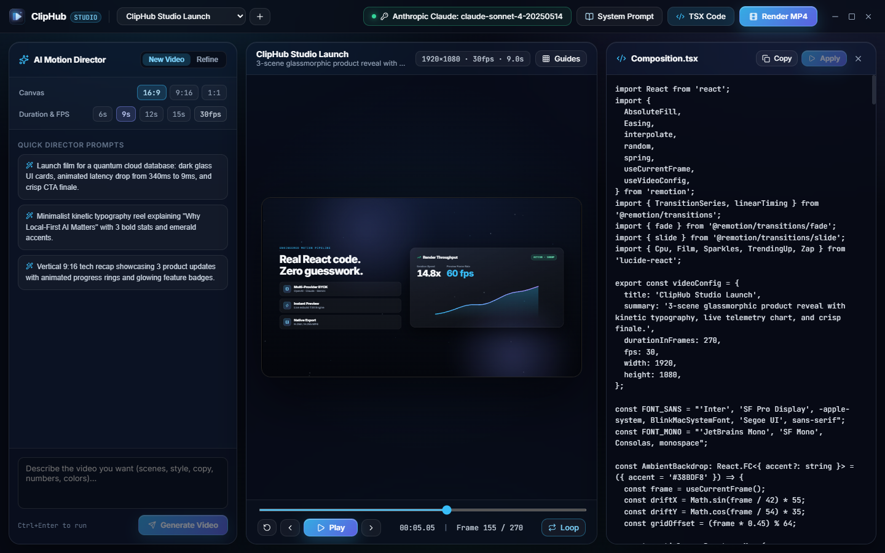
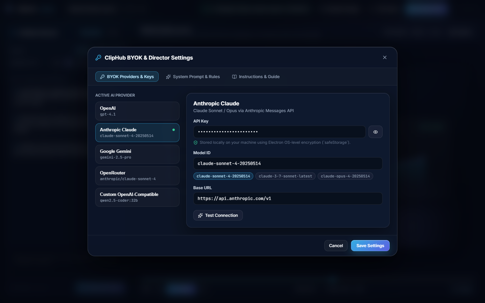
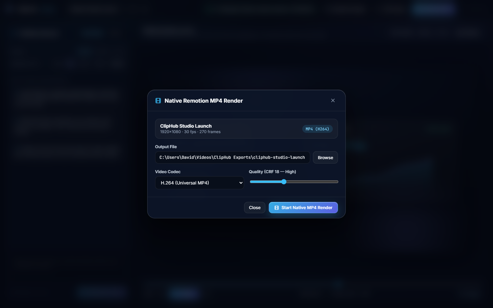

<p align="center">
  
</p>

<h1 align="center">ClipHub</h1>

<p align="center">
  <strong>Standalone AI Remotion Motion Studio with BYOK &amp; Native MP4 Rendering</strong><br/>
  Released into the public domain under <a href="LICENSE">The Unlicense</a>.
</p>

---

## Screenshots

### Motion Studio & Live Remotion Preview


### BYOK Providers & Director System Prompt


### Native Remotion MP4 Renderer


---

## Features

- **BYOK Multi-Provider AI**: Connect your own API key for **OpenAI**, **Anthropic Claude**, **Google Gemini**, **OpenRouter**, or any **Custom OpenAI-Compatible** endpoint (Ollama, LM Studio, vLLM, Groq). Keys are stored locally using Electron's OS-level encryption (`safeStorage`).
- **Elite Motion Director System Prompt**: Built-in choreography & deterministic Remotion React prompt (`src/shared/systemPrompt.ts`), inspectable and customizable right inside the app, plus persistent custom brand/style instructions and an interactive Director Guide.
- **Auto-Verify & Auto-Repair Loop**: Generated TSX is immediately compiled with `esbuild` and validated against the allowed Remotion runtime imports; if a syntax or import issue occurs, ClipHub automatically asks the model to repair it.
- **Live Glass Stage (`@remotion/player`)**: Frame-accurate timeline scrubbing, play/pause, frame stepping, loop toggle, safe-zone & rule-of-thirds guides, and an editable live `Composition.tsx` drawer.
- **Native MP4 Rendering**: Bundles and renders `H.264` or `H.265` MP4 files natively in an isolated Node worker (`@remotion/bundler` + `@remotion/renderer`) with real-time progress and cancellation.
- **Starter Showcase Compositions**: Pre-loaded multi-scene `16:9` and `9:16` Remotion templates so you can preview and export MP4s immediately.

---

## Download or Build from Source

Download the latest Windows release from the [Releases](../../releases) page, or run from source:

```bash
npm install
npm run dev     # Vite dev server + Electron
npm start       # Build and launch production Electron app
npm run dist    # Package Windows installer & portable exe
```

---

## BYOK Setup & Prompting Guide

1. Click the **Provider / Key** pill in the top bar (or open **System Prompt** -> **BYOK Providers & Keys**).
2. Choose your provider, paste your API key, select a model (e.g. `claude-sonnet-4-20250514`, `gemini-2.5-pro`, or `gpt-4.1`), and click **Test Connection**.
3. Describe your video in the **AI Motion Director** sidebar (mention story beats, palette, copy, numbers, and target aspect ratio `16:9` / `9:16` / `1:1`).
4. Iterate conversationally using **Refine** mode, or edit `Composition.tsx` directly.
5. Click **Render MP4** to export natively to `Videos/ClipHub Exports/`.

---

## License

This software is released into the public domain under **[The Unlicense](LICENSE)**.
